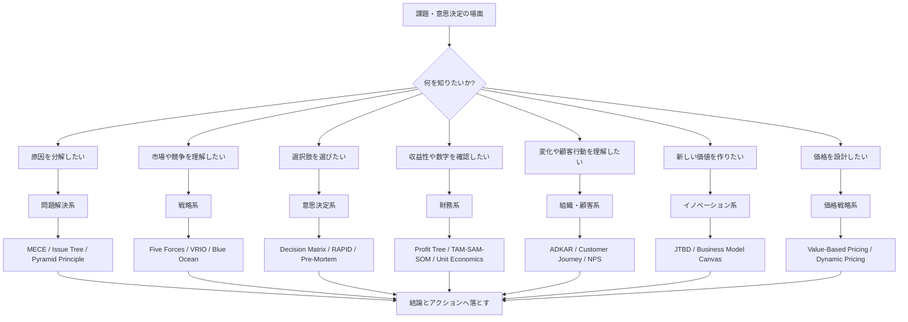
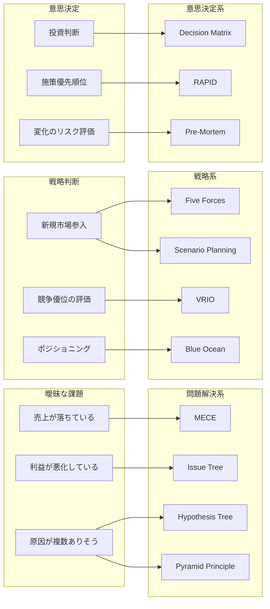

# フレームワーク概要と活用ケース 日本語版

> これは、リポジトリ内の各フレームワークを整理し、どのようなケースで使うと効果的かを説明するための資料です。
> 元の英語版は [frameworks-index.md](frameworks-index.md) および各カテゴリの md ファイルを参照してください。

## 1. このリポジトリの考え方

このリポジトリのフレームワーク群は、単なる知識の羅列ではありません。実務で最も重要なのは、次の3つを分けて考えることです。

- 事実と仮説を分ける
- 問題を構造化する
- 結論を先にし、根拠を後から重ねる

つまり、フレームワークの役割は「考えるための道具」であり、提案書や経営会議で使うための伝達構造を作るための基盤でもあります。

実務上は、次の順番で使うと分かりやすいです。

1. 問題を定義する
2. 問題を分解する
3. 仮説を立てる
4. 根拠を確認する
5. 結論と推奨アクションに落とす

---

## 2. フレームワークの大分類

このリポジトリでは、主に次の7カテゴリに整理されています。

- 問題解決
- 戦略
- 意思決定
- 財務
- 組織・顧客
- イノベーション
- 価格戦略

それぞれのカテゴリは、解決したい問いが違います。フレームワークを選ぶときは、まず「何を知りたいのか」を明確にすることが大事です。

### 図解1: フレームワーク全体の位置づけ

### 図解2: どのケースにどのフレームワークが向くか

---

## 3. 問題解決系フレームワーク

### 3-1. MECE

概要:
- 「漏れなく、重複なく」を意識して問題を分解する思考法
- 分析の土台として非常に重要

効果的なケース:
- 売上が急減しているが原因が不明なとき
- 施策の優先順位が分からないとき
- 顧客の離脱理由が散在しているとき

使い方:
- 原因をカテゴリ別に切る
- 重複しないように分割する
- それぞれが検証可能な仮説になるようにする

例:
- 売上低下 = 価格 × 数量 × 顧客数 × 商品構成
- コスト増 = 人件費 × 材料費 × 配送費 × 固定費

### 3-2. Issue Tree

概要:
- 問題を枝分かれさせて、根本原因を明らかにする
- 因果関係を視覚化しやすい

効果的なケース:
- 経営課題の原因が曖昧なとき
- なぜ利益が悪化しているのかを説明したいとき
- 事業のボトルネックを特定したいとき

強み:
- 問題の構造を見える化できる
- 何が原因で、何が二次的な要因か区別しやすい

注意点:
- 枝を広げすぎない
- 「理由を並べただけ」ではなく、因果の流れがあるか確認する

### 3-3. Hypothesis Tree

概要:
- 「仮説」を木構造で整理し、何を検証するべきか決める
- 調査や検証の設計に有効

効果的なケース:
- 新規事業の市場性を見極めたいとき
- 既存事業で原因仮説が複数あるとき
- アナリティクスやユーザー調査を設計したいとき

強み:
- 何を調査すべきかが明確になる
- 実証可能な仮説として扱いやすい

### 3-4. Pyramid Principle

概要:
- 結論 → 理由 → 根拠 の順に整理して提案する手法
- 経営層向けの説明に最適

効果的なケース:
- 役員会資料を作るとき
- 提案を簡潔に伝えたいとき
- 重要な結論を一番先に伝えたいとき

強み:
- エグゼクティブ向けの伝達に強い
- 「結論が先に来る」ことで意思決定をスピードアップする

### 3-5. SCQA

概要:
- Situation, Complication, Question, Answer
- 物語の流れで課題と結論を説明する

効果的なケース:
- 提案書や社内向け説明資料
- 事例紹介や要点整理
- 読者にストーリー性を持たせたいとき

---

## 4. 戦略系フレームワーク

### 4-1. Five Forces

概要:
- 業界の競争状況と収益性を評価する

効果的なケース:
- 新規市場参入の判断
- 業界構造を理解したいとき
- 競争優位が持続可能かを見たいとき

主な観点:
- 競争の激しさ
- 代替品の脅威
- 供給者の交渉力
- 顧客の交渉力
- 新規参入のしにくさ

### 4-2. Value Chain

概要:
- 企業が価値をどこで作っているかを整理する

効果的なケース:
- コスト構造を見える化したいとき
- 業務の改善ポイントを特定したいとき
- 事業のボトルネックを見つけたいとき

### 4-3. VRIO

概要:
- 自社の強みが持続可能かを見極める

効果的なケース:
- 競争優位の源泉を整理したいとき
- M&Aや事業戦略の判断で使いたいとき
- 自社能力の強さの評価に使いたいとき

### 4-4. Blue Ocean

概要:
- 競争のない価値空間を発見する

効果的なケース:
- 既存市場が飽和しているとき
- 価格競争に巻き込まれているとき
- 新しいセグメントやニッチ市場を探したいとき

### 4-5. Scenario Planning

概要:
- 将来の複数の可能性を想定して戦略を設計する

効果的なケース:
- 長期投資判断
- 政策や制度変更が大きく影響する領域
- 市場環境が不確実なとき

---

## 5. 意思決定系フレームワーク

### 5-1. RAPID

概要:
- 誰が意思決定を行い、誰が提案し、誰が実行するかを明確にする

効果的なケース:
- 複数部門が関わる意思決定
- 役割が曖昧で意思決定が遅いとき
- 社内の責任分担を整理したいとき

### 5-2. Decision Matrix

概要:
- 複数の選択肢を評価軸で比較する

効果的なケース:
- 戦略や投資の選定
- サービスや商材の選定
- 比較軸が曖昧で感情的に判断しやすいとき

### 5-3. Pre-Mortem

概要:
- 失敗したと仮定して、どこで失敗したかを事前に考える

効果的なケース:
- 大きな施策やプロジェクト立ち上げ時
- 失敗リスクが高い判断
- 事前に懸念を洗い出したいとき

### 5-4. Second-Order Thinking

概要:
- 一次的な影響だけでなく、2次・3次の効果まで見る

効果的なケース:
- 価格改定や人員配置の判断
- 規模拡大や撤退判断
- 施策の副次的な影響を重視したいとき

### 5-5. Inversion

概要:
- 成功条件ではなく、失敗の原因を逆に考える

効果的なケース:
- リスクを避けたいとき
- 運用上の失敗を防ぎたいとき
- 「何をやらないか」を判断したいとき

---

## 6. 財務系フレームワーク

### 6-1. Profit Tree

概要:
- 利益がどのように構成されているかを整理する

効果的なケース:
- 事業の利益率改善策を考えるとき
- 売上と原価の構成を見たいとき
- どの要因が利益を押し下げているか知りたいとき

### 6-2. Revenue Tree

概要:
- 収益がどの項目に依存しているかを分解する

効果的なケース:
- 売上改善策の設計
- 収益源の多様化
- 商品別・顧客別の構造を見るとき

### 6-3. Unit Economics

概要:
- 一件あたりの価値や利益を算出して、事業の健康状態を評価する

効果的なケース:
- SaaS、EC、B2Bサービス、マーケットプレイスの経営判断
- 1顧客あたりの利益が安定しているかを知りたいとき

### 6-4. TAM / SAM / SOM

概要:
- 市場規模を段階的に見積もる

効果的なケース:
- 投資判断
- 市場の大きさを説明したいとき
- 新規事業のポテンシャル評価

### 6-5. Waterfall

概要:
- 売上がどこでどのように利益へ変わるかを見える化する

効果的なケース:
- 事業計画の説明
- 収益性のボトルネック把握
- 予算・費用の見直し

---

## 7. 組織・顧客系フレームワーク

### 7-1. ADKAR

概要:
- 変化への受容プロセスを人の側面から整理する

効果的なケース:
- 組織変革
- 業務改革
- 新制度や新システム導入

### 7-2. Kotter / Lewin

概要:
- 変化を進めるための手順や理論

効果的なケース:
- 組織再編
- 文化変革
- 業務改善の実行計画

### 7-3. Customer Journey

概要:
- 顧客がサービスを利用する流れと接点を整理する

効果的なケース:
- UX改善
- 販売のボトルネック解消
- 離脱理由の特定

### 7-4. NPS

概要:
- 顧客満足やロイヤルティを簡易的に測る

効果的なケース:
- 顧客体験の改善
- サービス満足度評価
- 継続率やブランド評価の把握

---

## 8. イノベーション系フレームワーク

### 8-1. JTBD

概要:
- 顧客が何を成し遂げたいかに基づいて価値を定義する

効果的なケース:
- 新サービス開発
- 商品改善
- 顧客ニーズを深く理解したいとき

### 8-2. Business Model Canvas

概要:
- ビジネスモデルの主要要素を一枚で整理する

効果的なケース:
- 新規事業計画
- 事業モデルの棚卸し
- 収益源や価値提供の整合性確認

### 8-3. Value Proposition Canvas

概要:
- 客観的なニーズと、提供する価値の接点を整理する

効果的なケース:
- 商品の差別化
- 価値訴求の明確化
- ポジショニングの見直し

---

## 9. 価格戦略系フレームワーク

### 9-1. Value-Based Pricing

概要:
- 顧客が得る価値に応じて価格決定する

効果的なケース:
- 高付加価値サービス
- 価格を高くしながらも売れる業界
- 顧客の感覚価値を活用したいとき

### 9-2. Cost-Plus Pricing

概要:
- 原価に一定の利益率を加えて価格を決める

効果的なケース:
- 製造業や仕入れを中心にしたビジネス
- 価格設定の簡便さが重要なとき

### 9-3. Competitive Pricing

概要:
- 競合価格を基準に設定する

効果的なケース:
- 市場で価格競争があるとき
- 価格感度が高い業界

### 9-4. Dynamic Pricing

概要:
- 需要や時間に応じて価格を変動させる

効果的なケース:
- 需要変動が大きいサービス
- 交通・宿泊・オンライン販売など

### 9-5. Freemium

概要:
- 基本無料で、追加価値を有料化する

効果的なケース:
- SaaSやデジタルサービス
- ユーザー獲得を重視した事業

---

## 10. どのフレームワークを選ぶべきか

フレームワーク選定の基本は、次の問いで決めると分かりやすいです。

- 何がわからないのか
- どの意思決定に使うのか
- どの粒度で整理したいのか
- どの相手に伝えるのか

### 典型的な判断例

- 事業の原因が曖昧 → Issue Tree, MECE, Hypothesis Tree
- 経営会議で結論を早く伝えたい → Pyramid Principle, SCQA
- 市場価値や競争優位を見たい → Five Forces, VRIO, Blue Ocean
- 施策を選ぶとき → Decision Matrix, Pre-Mortem, RAPID
- 収益性を確認したい → Profit Tree, Revenue Tree, Unit Economics
- 組織変革を進めたい → ADKAR, Kotter, Lewin
- 価格の設計をしたい → Value-Based Pricing, Dynamic Pricing, Freemium

---

## 11. 実務での使い方のコツ

1. まず問いを定義する
   - 何を解決したいのかを明確にする

2. 一番適したカテゴリを選ぶ
   - 例: 「売上が下がった」なら問題解決系
   - 例: 「新規市場に入るか」なら戦略系

3. フレームワークを「ただ使う」のではなく、「結論に繋げる」
   - 解析で終わらせず、提案やアクションへ落とす

4. 根拠を持つ
   - 感覚ではなく、データ、観察、事実を通して判断する

5. 経営層向けなら伝達形式を整える
   - 結論を先に、根拠を後に置く

---

## 12. まとめ

このリポジトリのフレームワーク群は、経営課題の解決に必要な思考の骨格を提供します。

- 問題を分解したい → 問題解決系
- 競争と事業の方向性を見たい → 戦略系
- 判断の妥当性を高めたい → 意思決定系
- 収益性を定量化したい → 財務系
- 人や顧客の動きを理解したい → 組織・顧客系
- 新しい価値を作りたい → イノベーション系
- 価格を設計したい → 価格戦略系

重要なのは、単にフレームワークを暗記することではなく、
「どの質問にどのフレームワークを使えばよいか」を意識して使うことです。

こうした見方を持つと、関連する資料や実践例を読むときも、より理解しやすくなります。

---

## 13. 関連資料

- [frameworks-index_JP.md](frameworks-index_JP.md)
- [frameworks-problem-solving_JP.md](frameworks-problem-solving_JP.md)
- [frameworks-strategy_JP.md](frameworks-strategy_JP.md)
- [frameworks-decision_JP.md](frameworks-decision_JP.md)
- [frameworks-financial_JP.md](frameworks-financial_JP.md)
- [frameworks-operations_JP.md](frameworks-operations_JP.md)
- [frameworks-innovation_JP.md](frameworks-innovation_JP.md)
- [frameworks-pricing_JP.md](frameworks-pricing_JP.md)
- [SKILL_JP.md](../SKILL_JP.md)
